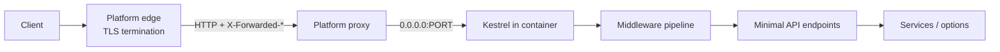

# Architecture

## Request flow

The platform proxy is the only externally reachable hop. TLS terminates there,
so the app serves plain HTTP and never calls `UseHttpsRedirection` or `UseHsts`.

## Composition

`Program.cs` is the composition root and does four things:

1. `CreateSlimBuilder` creates a builder with the smaller default surface.
2. `ConfigureServerlessHost` binds `$PORT`, sets a 25-second shutdown timeout,
   and keeps console logging only.
3. `AddApiServices` registers ProblemDetails, validation, OpenAPI, options, and
   application services.
4. `UseApiPipeline` adds middleware; `MapApiEndpoints` maps all routes.

## Folder responsibilities

| Folder | Responsibility |
|--------|----------------|
| `Endpoints/` | Route definitions and OpenAPI metadata. `EndpointRouteBuilderExtensions` is the single mapping entry point. |
| `Models/` | Request and response records. Only `EchoRequest` has validation attributes. |
| `Services/` | Application logic. `IGreetingService` exists to show constructor-injected DI; add real services here. |
| `Options/` | Strongly typed configuration bound from `IConfiguration`. |
| `Extensions/` | Host, service, and pipeline wiring kept out of `Program.cs`. |

There are no controllers, repositories, or layers. Add them only when a feature
needs them; the endpoint and DI extension points do not have to move.

## Middleware order

`UseApiPipeline` applies middleware in this order:

1. `UseForwardedHeaders` — restores the original scheme and client IP from
   `X-Forwarded-Proto` / `X-Forwarded-For`.
2. `UseExceptionHandler` — converts unhandled exceptions into ProblemDetails.
   `BadHttpRequestException` keeps its status code, so malformed JSON returns
   400 rather than 500.
3. `UseStatusCodePages` — writes ProblemDetails for empty 4xx/5xx responses,
   including 404 and 405.
4. OpenAPI and Swagger UI, only when `Docs:Enabled` is `true`.

Endpoints are mapped after the pipeline, so routing and endpoint metadata apply
to every handler.

## Container contract

The app is portable because it depends on nothing platform-specific:

| Requirement | Implementation |
|-------------|----------------|
| Listen on `0.0.0.0:$PORT` | `ConfigureServerlessHost`, default `8080` |
| Log to stdout/stderr | `ClearProviders` + `AddConsole`; no file sinks |
| Handle `SIGTERM` gracefully | `HostOptions.ShutdownTimeout = 25s` |
| Be stateless | No in-memory application state; config from environment |
| Expose a liveness route | `GET /health` returns `{"status":"ok"}` |
| Survive a missing ICU | `InvariantGlobalization=true` in the project file |

The Docker image adds `ASPNETCORE_FORWARDEDHEADERS_ENABLED=true`, which makes the
forwarded-headers middleware trust the platform proxy. It also disables the
diagnostics IPC server with `DOTNET_EnableDiagnostics=0`.

## Why Minimal APIs

Controllers would add a `Controllers/` folder, attribute routing, and model
binding conventions without adding capability. Minimal APIs keep the route,
handler, and OpenAPI metadata in one place, which is the point of a starter
template. The structure above still leaves room for controllers if a project
grows into them.
